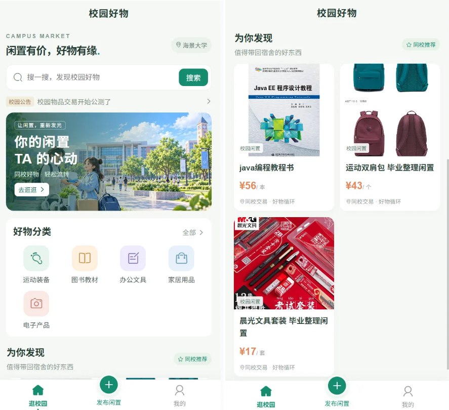
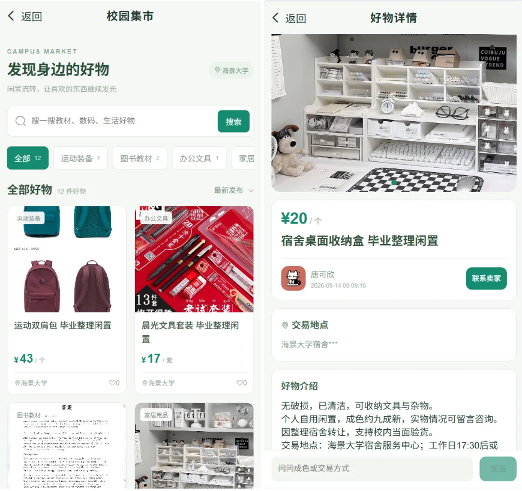
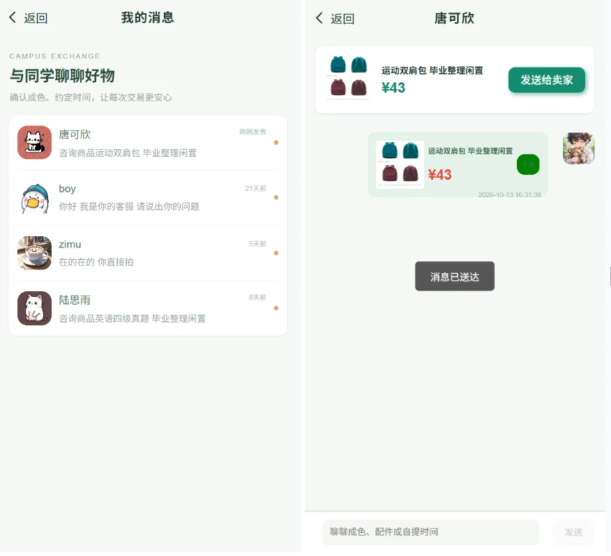
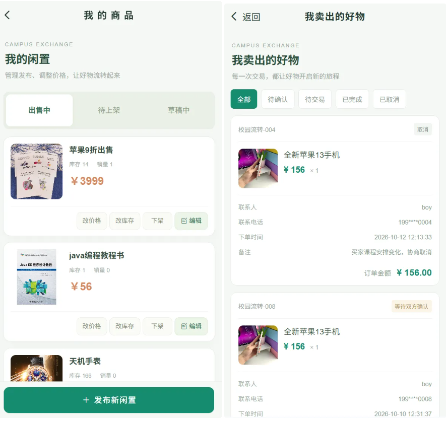
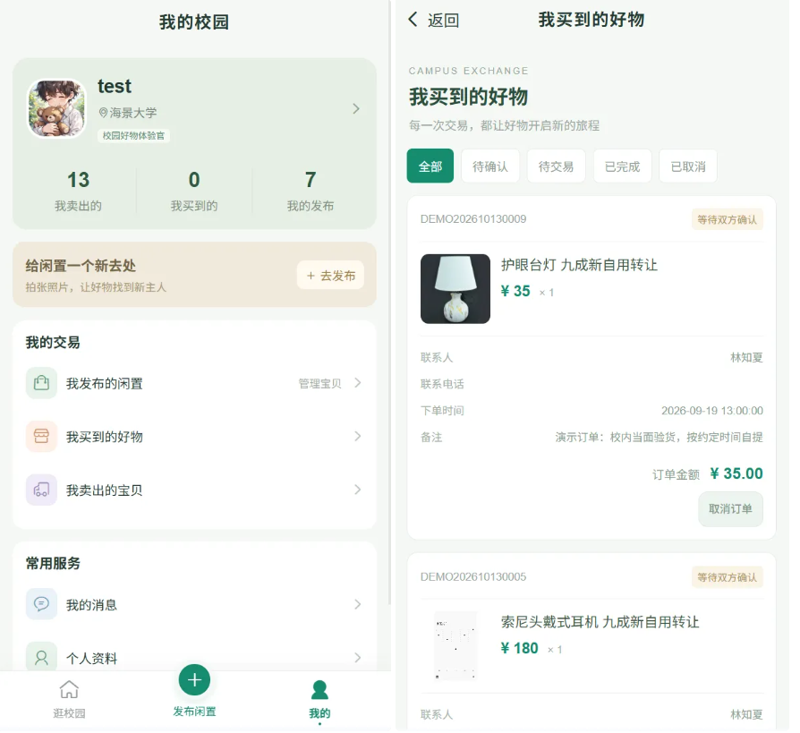
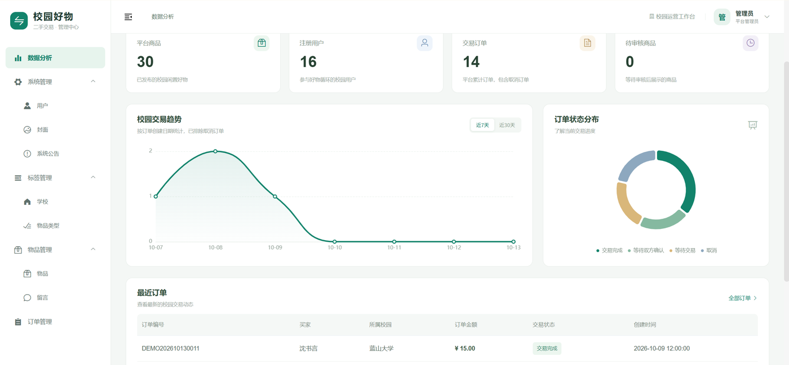
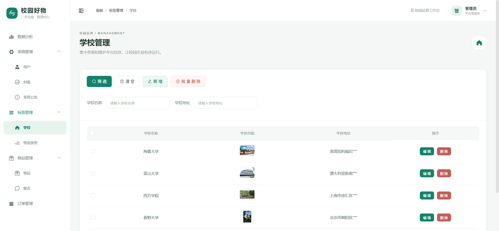
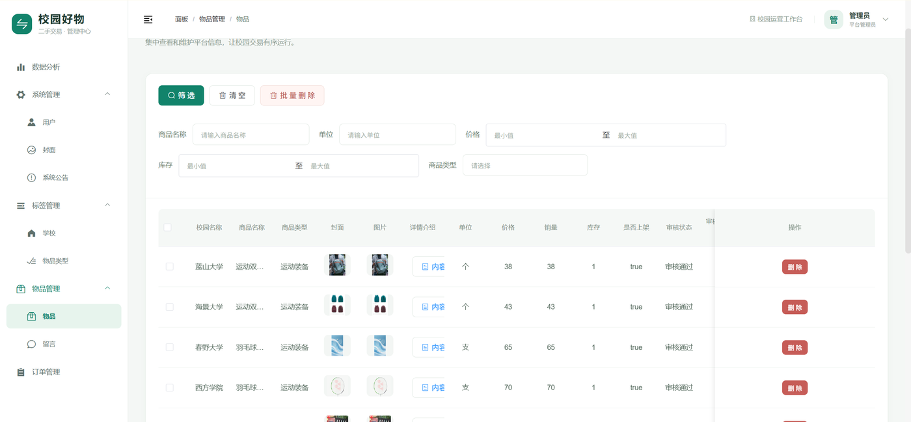
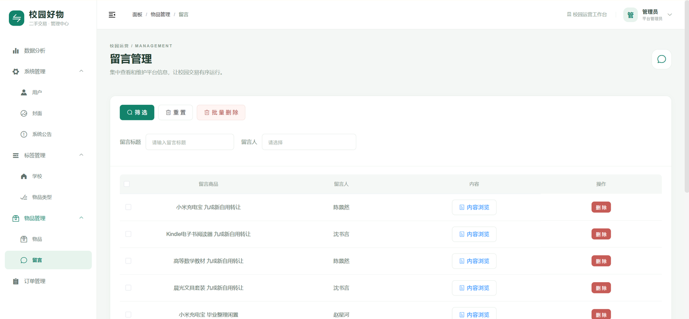
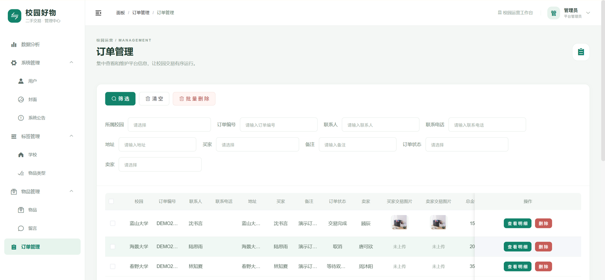

# Campussecond-handtradingprogram
校园二手交易小程序 
亮点：协同过滤推荐、Echarts数据看板、交易聊天与商品卡片、同校闲置流转、发布到面交的交易流程； 可加ia功能，免费。
角色：用户（卖家、买家）、管理员；

所有源码均本人开发，项目是前后端分离的，所有的项目都具备了完整的业务逻辑，不仅仅局限于基础的增删改查（CRUD）操作，系统亮点众多。

本文注重于计算机毕业设计选题指导，列出题目均有源码， 大家可以去【公众号】(毕业终点站)获取或者加我【qq】(2112698948)提意见(别忘记Star哟)。备注：git

声明：仅用于学习使用，请勿用于任何商业行为！

1.系统非商用，非开源，非无偿。

2.由本人开发，如需源码，请联系以下方式，qq:2112698948。 个人网站：https://home.biyecode.com

3.项目有很多，并未全部上传，如果未找到想要的，可直接咨询。

# 校园二手交易小程序

> 基于 Spring Boot 3 + uni-app 的校园闲置交易平台，微信小程序端 + 管理后台，管理员与校园用户双角色。
> 把发布、审核、私信、下单和线下面交连成一条线，让教材、数码、文具这些闲置在校园里找到下一位主人。

## 一、项目简介

这是一套面向校园的二手交易应用。学生按所属校园浏览同校闲置、发布自己的闲置、和卖家私信沟通成色与面交安排，下单后上传照片留证；管理员在后台维护校园与分类、审核发布、处理留言和订单，并用数据看板了解交易情况。

系统里几个花心思的地方：

- **协同过滤推荐**：基于用户购买记录构建商品偏好，用余弦相似度找兴趣相近的同学；行为数据不足时回退到同校最新商品推荐。
- **ECharts 数据看板**：从真实订单记录生成近 7 天 / 30 天趋势和状态分布，帮助管理员了解交易情况与审核任务。
- **交易私信与商品卡片**：支持文字消息、商品卡片和下单入口，方便买卖双方沟通商品成色、价格与面交安排。
- **同校闲置流转**：商品分类与查询关联校园，方便同学寻找身边的教材、文具、数码和运动装备。
- **从发布到面交的交易流程**：闲置发布、后台审核、留言咨询、私信沟通、下单与照片留证相互衔接，适合校园线下交易。

## 二、技术栈

| 分层 | 技术 |
|---|---|
| 架构 | 前后端分离、MVC，微信小程序端 + 管理后台，管理员 / 校园用户双角色 |
| 后端 | Java、Spring Boot 3、Spring MVC、MyBatis-Plus、MySQL、JWT、基于用户的协同过滤推荐 |
| 后台 | Vue 2、Vue CLI、Element UI、Vue Router、Vuex、Axios、ECharts |
| 小程序 | uni-app、Vue 2、Vuex、ColorUI、微信小程序 API |
| 环境 | Windows / IDEA / JDK 17 / Maven / MySQL / Node.js / HBuilderX / 微信开发者工具 |

## 三、系统功能

### 3.1 用户端
- 注册登录：选择所属校园、注册账号，登录后管理个人资料
- 好物浏览：查看同校商品分类、推荐闲置、校园公告，按关键词搜索商品
- 商品详情：查看图片、价格、商品介绍和交易地点，留言咨询卖家
- 发布闲置：上传封面和主图，填写商品信息，保存草稿，管理价格、库存与上下架
- 交易沟通：与卖家发送文字消息和商品卡片，从商品卡片进入订单确认
- 订单管理：填写订单信息，查看买入与卖出记录，确认或取消交易，上传线下面交照片留证
- 个人中心：查看买入、卖出与发布统计，进入订单、消息和个人资料页面

### 3.2 管理员端
- 用户管理：维护用户资料、所属校园与账号信息
- 校园与分类管理：维护学校信息和各校园的商品分类
- 商品管理：查看闲置商品，审核发布内容，维护价格、库存和上架状态
- 公告与轮播图管理：发布校园公告，维护首页宣传图片
- 留言与订单管理：查看商品留言，查询和维护校园交易订单
- 数据看板：查看商品、用户、订单和待审核数量，展示近 7 天 / 30 天交易趋势与订单状态分布

## 四、系统截图

以下选取 10 张代表性截图，按两个角色分别展示。源文档首图为管理中心登录入口页，未提供独立的系统总览图。小程序端截图为左右两页拼接的双屏图，按整张全宽展示。

### 4.1 用户端

**首页与为你发现** —— 左页是校园首页，含搜索、校园公告、好物分类和为你发现入口；右页是按同校推荐展示的商品流，每件商品带价格、校园和好物循环标签，对应协同过滤推荐与同校闲置流转。

**校园市集与商品详情** —— 左页按分类筛选同校商品，可按最新发布排序；右页是商品详情，展示图片、价格、卖家、交易地点和好物介绍，并可联系卖家或留言咨询。

**联系卖家** —— 左页是消息列表，展示与各位同学的咨询会话；右页是聊天界面，可发送文字消息和商品卡片（图片 + 名称 + 价格），从卡片进入下单，对应交易私信与商品卡片。

**我的商品与卖出记录** —— 左页管理发布的闲置，区分出售中、待上架、草稿中，可改价格、改库存、下架和编辑；右页是卖出的好物，按待确认、待交易、已完成、已取消查看订单。

**个人中心与买入记录** —— 左页展示卖出、买入和发布数量，提供发布、我发布的闲置、我买到的好物、我卖出的宝贝、我的消息等入口；右页是买到的好物订单列表。

### 4.2 管理员端

**数据分析** —— 平台商品、注册用户、交易订单、待审核商品指标卡，配合校园交易趋势折线图（近 7 天 / 30 天）、订单状态分布环形图和最近订单列表，对应 ECharts 数据看板。

**学校管理** —— 维护学校名称、封面和地址，支持新增、编辑与批量删除，为同校闲置流转提供校园基础数据。

**物品管理** —— 按商品名称、单位、价格、库存和类型筛选，列表展示校园、商品名称、类型、封面、价格、销量、库存、上架与审核状态，支持删除，对应发布内容审核。

**留言管理** —— 查看商品留言的标题、留言人、内容，支持内容浏览与删除，配合用户端的留言咨询形成完整沟通记录。

**订单管理** —— 按校园、订单编号、联系人、电话、地址、买家、备注和订单状态筛选，列表展示校园交易订单及买家卖家交图照片，支持查看详情与删除，对应交易维护与面交留证。

---

文档展示 10 张截图，需要了解更多，请联系我。
